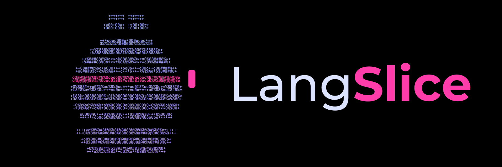
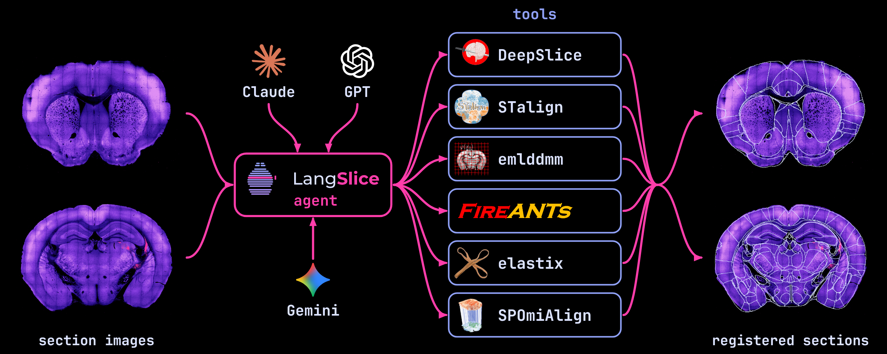

<p align="center">
  
</p>

<p align="center">
  <a href="https://github.com/greenpolo/LangSlice/blob/main/LICENSE"></a>
  <a href="https://www.python.org/downloads/"></a>
  <a href="https://github.com/greenpolo/LangSlice/actions/workflows/tests.yml"></a>
  <a href="https://langslice.readthedocs.io"></a>
</p>

<p align="center">
  <em>Agent-driven registration of histological brain sections to BrainGlobe atlases.</em>
</p>

<p align="center">
  
</p>

LangSlice gives a vision-language agent tools to register a stack of histology
sections to a [BrainGlobe](https://brainglobe.info) atlas. The agent inspects
the anatomy, sets positions and cutting angles, aligns sections in-plane,
and optionally fits SyN deformations. It chooses regions and settings and
can use an image model to trace borders where useful.

Source images stay unchanged. Work is checkpointed and undoable, with
coordinate and label maps, `registration.json`, and QuickNII / VisuAlign
exports. Coronal sections of the Allen mouse atlas are the most tested case.

## Install

In a terminal with conda ([Miniforge](https://conda-forge.org/download/)):

```bash
conda create -n langslice python=3.11 -y
conda activate langslice
pip install "langslice[registration,mcp]"
langslice login        # ChatGPT sign-in; or set OPENAI_API_KEY / GEMINI_API_KEY (see .env.example)
```

From the source instead: download and extract it, open a terminal in the
folder with `environment.yml`, and run `conda env create -f environment.yml`.
On Windows, run the commands in Miniforge Prompt. Python 3.11 is required.
Atlases are downloaded by BrainGlobe on first use into the user's
`.brainglobe` folder. The environment includes the deformable engine
(FireANTs on torch), the MCP server and the worker the ABBA connector starts.

## Use LangSlice

- **[Getting started](https://github.com/greenpolo/LangSlice/blob/main/docs/getting-started/install.md):** install LangSlice,
  connect the AI app you already use (Codex, Antigravity or Claude Code) and
  [register a brain](https://github.com/greenpolo/LangSlice/blob/main/docs/register.md).
- **[Agents, CLI and MCP](https://github.com/greenpolo/LangSlice/blob/main/docs/agents/index.md):** Claude Code, Antigravity or Codex
  through `langslice-job`, Claude Desktop through MCP, or the built-in agent with
  `langslice linear run sections/`.
- **[ABBA](https://github.com/greenpolo/LangSlice/blob/main/docs/abba.md):** start a job from the sections selected in ABBA;
  the agent's changes appear in ABBA as it saves them.
- **[Python](https://github.com/greenpolo/LangSlice/blob/main/docs/developers/library.md):** coding agents can open a job and write their
  own workflows using the same tools.

[Tools](https://github.com/greenpolo/LangSlice/blob/main/docs/tools.md) ·
[Tool plugins](https://github.com/greenpolo/LangSlice/blob/main/docs/developers/plugins.md) ·
[File formats](https://github.com/greenpolo/LangSlice/blob/main/docs/reference/file_formats.md) ·
[Architecture](https://github.com/greenpolo/LangSlice/blob/main/docs/developers/architecture.md) ·
[Full documentation](https://langslice.readthedocs.io)

## Citation and license

Cite the project metadata in [`CITATION.cff`](https://github.com/greenpolo/LangSlice/blob/main/CITATION.cff) (GitHub's "Cite this
repository" button). BSD-3-Clause; see [`LICENSE`](https://github.com/greenpolo/LangSlice/blob/main/LICENSE).
